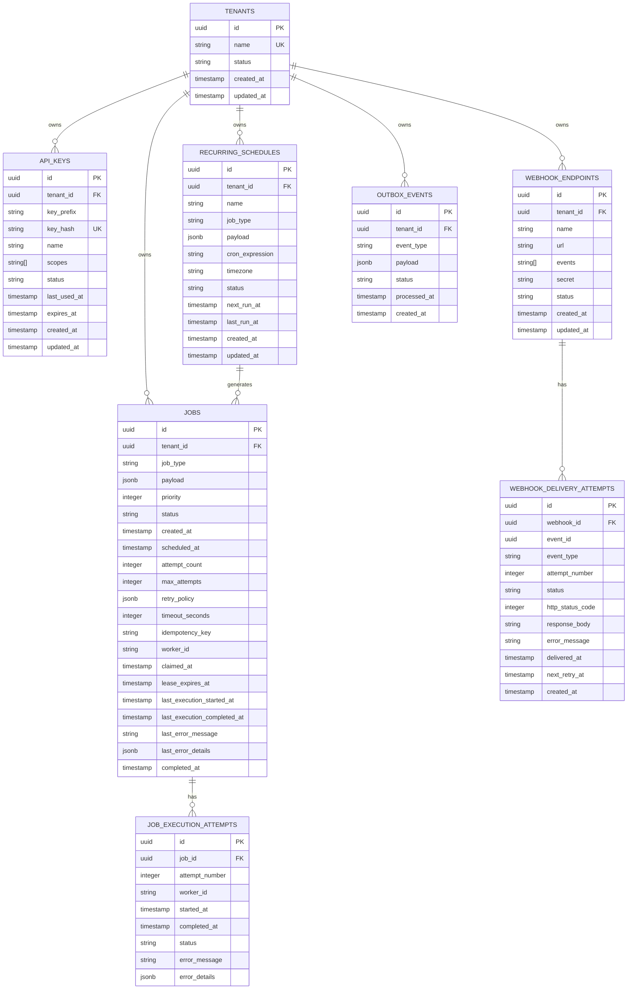

# NEXUS CORE - Database Design

## Initial Entities

### Tenants

**Responsibility:** Store tenant (organization/customer) information and configuration.

**Primary Key:** `id` (UUID)

**Foreign Keys:** None

**Important Constraints:**
- `name` must be unique
- `created_at` is set on insert
- `updated_at` is auto-updated

**Indexes:**
- `idx_tenants_name` on `name` (unique)

**Tenant Ownership:** This is the root entity for tenant isolation.

**Data Retention:** Permanent (soft delete if needed in future)

```sql
CREATE TABLE tenants (
    id UUID PRIMARY KEY DEFAULT gen_random_uuid(),
    name VARCHAR(255) NOT NULL UNIQUE,
    status VARCHAR(50) NOT NULL DEFAULT 'ACTIVE',
    created_at TIMESTAMP NOT NULL DEFAULT CURRENT_TIMESTAMP,
    updated_at TIMESTAMP NOT NULL DEFAULT CURRENT_TIMESTAMP
);

CREATE INDEX idx_tenants_name ON tenants(name);
```

### API Keys

**Responsibility:** Store securely hashed API keys for tenant authentication.

**Primary Key:** `id` (UUID)

**Foreign Keys:** `tenant_id` → `tenants(id)`

**Important Constraints:**
- `key_hash` must be unique
- `tenant_id` references valid tenant
- `status` is either 'ACTIVE' or 'REVOKED'
- `expires_at` can be NULL for keys that don't expire

**Indexes:**
- `idx_api_keys_key_hash` on `key_hash` (unique)
- `idx_api_keys_tenant_id` on `tenant_id`
- `idx_api_keys_status` on `status`

**Tenant Ownership:** `tenant_id` - all queries must filter by tenant

**Data Retention:** Retain for audit purposes, soft delete recommended

```sql
CREATE TABLE api_keys (
    id UUID PRIMARY KEY DEFAULT gen_random_uuid(),
    tenant_id UUID NOT NULL REFERENCES tenants(id) ON DELETE CASCADE,
    key_prefix VARCHAR(10) NOT NULL,
    key_hash VARCHAR(255) NOT NULL UNIQUE,
    name VARCHAR(255),
    scopes TEXT[],
    status VARCHAR(50) NOT NULL DEFAULT 'ACTIVE',
    last_used_at TIMESTAMP,
    expires_at TIMESTAMP,
    created_at TIMESTAMP NOT NULL DEFAULT CURRENT_TIMESTAMP,
    updated_at TIMESTAMP NOT NULL DEFAULT CURRENT_TIMESTAMP
);

CREATE INDEX idx_api_keys_key_hash ON api_keys(key_hash);
CREATE INDEX idx_api_keys_tenant_id ON api_keys(tenant_id);
CREATE INDEX idx_api_keys_status ON api_keys(status);
```

### Jobs

**Responsibility:** Store job definitions, state, and execution metadata.

**Primary Key:** `id` (UUID)

**Foreign Keys:** `tenant_id` → `tenants(id)`

**Important Constraints:**
- `idempotency_key` must be unique per tenant
- `tenant_id` references valid tenant
- `status` must be a valid job state
- `priority` must be between 0-10 (higher = higher priority)
- `attempt_count` cannot exceed `max_attempts`

**Indexes:**
- `idx_jobs_tenant_id` on `tenant_id`
- `idx_jobs_status` on `status`
- `idx_jobs_scheduled_at` on `scheduled_at`
- `idx_jobs_tenant_idempotency` on `(tenant_id, idempotency_key)` (unique)
- `idx_jobs_claimable` on `(status, scheduled_at)` for worker polling

**Tenant Ownership:** `tenant_id` - all queries must filter by tenant

**Data Retention:** Configurable per tenant (e.g., 90 days for completed jobs)

```sql
CREATE TABLE jobs (
    id UUID PRIMARY KEY DEFAULT gen_random_uuid(),
    tenant_id UUID NOT NULL REFERENCES tenants(id) ON DELETE CASCADE,
    job_type VARCHAR(255) NOT NULL,
    payload JSONB NOT NULL,
    priority INTEGER NOT NULL DEFAULT 5,
    status VARCHAR(50) NOT NULL DEFAULT 'PENDING',
    created_at TIMESTAMP NOT NULL DEFAULT CURRENT_TIMESTAMP,
    scheduled_at TIMESTAMP NOT NULL DEFAULT CURRENT_TIMESTAMP,
    attempt_count INTEGER NOT NULL DEFAULT 0,
    max_attempts INTEGER NOT NULL DEFAULT 3,
    retry_policy JSONB,
    timeout_seconds INTEGER,
    idempotency_key VARCHAR(255),
    worker_id VARCHAR(255),
    claimed_at TIMESTAMP,
    lease_expires_at TIMESTAMP,
    last_execution_started_at TIMESTAMP,
    last_execution_completed_at TIMESTAMP,
    last_error_message TEXT,
    last_error_details JSONB,
    completed_at TIMESTAMP,
    CONSTRAINT chk_jobs_priority CHECK (priority >= 0 AND priority <= 10),
    CONSTRAINT chk_jobs_attempt_count CHECK (attempt_count <= max_attempts)
);

CREATE INDEX idx_jobs_tenant_id ON jobs(tenant_id);
CREATE INDEX idx_jobs_status ON jobs(status);
CREATE INDEX idx_jobs_scheduled_at ON jobs(scheduled_at);
CREATE UNIQUE INDEX idx_jobs_tenant_idempotency ON jobs(tenant_id, idempotency_key) WHERE idempotency_key IS NOT NULL;
CREATE INDEX idx_jobs_claimable ON jobs(status, scheduled_at) WHERE status IN ('QUEUED', 'RETRY_WAIT');
```

### Job Execution Attempts

**Responsibility:** Track individual execution attempts for each job.

**Primary Key:** `id` (UUID)

**Foreign Keys:** `job_id` → `jobs(id)`

**Important Constraints:**
- `job_id` references valid job
- `attempt_number` must be positive
- `started_at` must be before `completed_at`

**Indexes:**
- `idx_job_attempts_job_id` on `job_id`
- `idx_job_attempts_attempt_number` on `(job_id, attempt_number)` (unique)

**Tenant Ownership:** Inherited from parent job

**Data Retention:** Same retention policy as parent job

```sql
CREATE TABLE job_execution_attempts (
    id UUID PRIMARY KEY DEFAULT gen_random_uuid(),
    job_id UUID NOT NULL REFERENCES jobs(id) ON DELETE CASCADE,
    attempt_number INTEGER NOT NULL,
    worker_id VARCHAR(255),
    started_at TIMESTAMP NOT NULL DEFAULT CURRENT_TIMESTAMP,
    completed_at TIMESTAMP,
    status VARCHAR(50) NOT NULL,
    error_message TEXT,
    error_details JSONB,
    CONSTRAINT chk_job_attempts_started_before_completed CHECK (completed_at IS NULL OR started_at <= completed_at)
);

CREATE INDEX idx_job_attempts_job_id ON job_execution_attempts(job_id);
CREATE UNIQUE INDEX idx_job_attempts_attempt_number ON job_execution_attempts(job_id, attempt_number);
```

### Recurring Schedules

**Responsibility:** Store recurring schedule definitions separate from individual job executions.

**Primary Key:** `id` (UUID)

**Foreign Keys:** `tenant_id` → `tenants(id)`

**Important Constraints:**
- `tenant_id` references valid tenant
- `cron_expression` must be a valid cron expression
- `timezone` must be a valid IANA timezone
- `status` is either 'ACTIVE' or 'PAUSED'

**Indexes:**
- `idx_schedules_tenant_id` on `tenant_id`
- `idx_schedules_status` on `status`
- `idx_schedules_next_run` on `next_run_at`

**Tenant Ownership:** `tenant_id` - all queries must filter by tenant

**Data Retention:** Permanent (soft delete recommended)

```sql
CREATE TABLE recurring_schedules (
    id UUID PRIMARY KEY DEFAULT gen_random_uuid(),
    tenant_id UUID NOT NULL REFERENCES tenants(id) ON DELETE CASCADE,
    name VARCHAR(255) NOT NULL,
    job_type VARCHAR(255) NOT NULL,
    payload JSONB NOT NULL,
    cron_expression VARCHAR(100) NOT NULL,
    timezone VARCHAR(50) NOT NULL DEFAULT 'UTC',
    status VARCHAR(50) NOT NULL DEFAULT 'ACTIVE',
    next_run_at TIMESTAMP NOT NULL,
    last_run_at TIMESTAMP,
    created_at TIMESTAMP NOT NULL DEFAULT CURRENT_TIMESTAMP,
    updated_at TIMESTAMP NOT NULL DEFAULT CURRENT_TIMESTAMP
);

CREATE INDEX idx_schedules_tenant_id ON recurring_schedules(tenant_id);
CREATE INDEX idx_schedules_status ON recurring_schedules(status);
CREATE INDEX idx_schedules_next_run ON recurring_schedules(next_run_at);
```

### Webhook Endpoints

**Responsibility:** Store webhook endpoint configurations for event delivery.

**Primary Key:** `id` (UUID)

**Foreign Keys:** `tenant_id` → `tenants(id)`

**Important Constraints:**
- `tenant_id` references valid tenant
- `url` must be a valid URL
- `status` is either 'ACTIVE' or 'INACTIVE'

**Indexes:**
- `idx_webhooks_tenant_id` on `tenant_id`
- `idx_webhooks_status` on `status`

**Tenant Ownership:** `tenant_id` - all queries must filter by tenant

**Data Retention:** Permanent (soft delete recommended)

```sql
CREATE TABLE webhook_endpoints (
    id UUID PRIMARY KEY DEFAULT gen_random_uuid(),
    tenant_id UUID NOT NULL REFERENCES tenants(id) ON DELETE CASCADE,
    name VARCHAR(255) NOT NULL,
    url VARCHAR(2048) NOT NULL,
    events TEXT[] NOT NULL,
    secret VARCHAR(255),
    status VARCHAR(50) NOT NULL DEFAULT 'ACTIVE',
    created_at TIMESTAMP NOT NULL DEFAULT CURRENT_TIMESTAMP,
    updated_at TIMESTAMP NOT NULL DEFAULT CURRENT_TIMESTAMP
);

CREATE INDEX idx_webhooks_tenant_id ON webhook_endpoints(tenant_id);
CREATE INDEX idx_webhooks_status ON webhook_endpoints(status);
```

### Webhook Delivery Attempts

**Responsibility:** Track individual webhook delivery attempts.

**Primary Key:** `id` (UUID)

**Foreign Keys:** `webhook_id` → `webhook_endpoints(id)`

**Important Constraints:**
- `webhook_id` references valid webhook endpoint
- `attempt_number` must be positive
- `status` must be a valid delivery status

**Indexes:**
- `idx_webhook_deliveries_webhook_id` on `webhook_id`
- `idx_webhook_deliveries_event_id` on `event_id`
- `idx_webhook_deliveries_status` on `status`

**Tenant Ownership:** Inherited from parent webhook

**Data Retention:** Configurable (e.g., 30 days)

```sql
CREATE TABLE webhook_delivery_attempts (
    id UUID PRIMARY KEY DEFAULT gen_random_uuid(),
    webhook_id UUID NOT NULL REFERENCES webhook_endpoints(id) ON DELETE CASCADE,
    event_id UUID NOT NULL,
    event_type VARCHAR(255) NOT NULL,
    attempt_number INTEGER NOT NULL,
    status VARCHAR(50) NOT NULL,
    http_status_code INTEGER,
    response_body TEXT,
    error_message TEXT,
    delivered_at TIMESTAMP,
    next_retry_at TIMESTAMP,
    created_at TIMESTAMP NOT NULL DEFAULT CURRENT_TIMESTAMP
);

CREATE INDEX idx_webhook_deliveries_webhook_id ON webhook_delivery_attempts(webhook_id);
CREATE INDEX idx_webhook_deliveries_event_id ON webhook_delivery_attempts(event_id);
CREATE INDEX idx_webhook_deliveries_status ON webhook_delivery_attempts(status);
```

### Outbox Events

**Responsibility:** Store events for reliable webhook delivery using transactional outbox pattern.

**Primary Key:** `id` (UUID)

**Foreign Keys:** `tenant_id` → `tenants(id)`

**Important Constraints:**
- `tenant_id` references valid tenant
- `status` must be a valid outbox status
- `processed_at` must be set when status is 'PROCESSED'

**Indexes:**
- `idx_outbox_tenant_id` on `tenant_id`
- `idx_outbox_status` on `status`
- `idx_outbox_created_at` on `created_at`

**Tenant Ownership:** `tenant_id` - all queries must filter by tenant

**Data Retention:** Short-term (e.g., 7 days for processed events)

```sql
CREATE TABLE outbox_events (
    id UUID PRIMARY KEY DEFAULT gen_random_uuid(),
    tenant_id UUID NOT NULL REFERENCES tenants(id) ON DELETE CASCADE,
    event_type VARCHAR(255) NOT NULL,
    payload JSONB NOT NULL,
    status VARCHAR(50) NOT NULL DEFAULT 'PENDING',
    processed_at TIMESTAMP,
    created_at TIMESTAMP NOT NULL DEFAULT CURRENT_TIMESTAMP
);

CREATE INDEX idx_outbox_tenant_id ON outbox_events(tenant_id);
CREATE INDEX idx_outbox_status ON outbox_events(status);
CREATE INDEX idx_outbox_created_at ON outbox_events(created_at);
```

## Entity Relationship Diagram



## Indexing Strategy

### General Principles

1. **Foreign keys** - Index all foreign key columns
2. **Query patterns** - Index columns used in WHERE clauses, JOIN conditions, and ORDER BY
3. **Uniqueness** - Unique indexes for business constraints
4. **Composite indexes** - For queries filtering on multiple columns
5. **Partial indexes** - For frequently filtered subsets (e.g., status = 'QUEUED')

### Worker Polling Optimization

The `idx_jobs_claimable` partial index is critical for worker performance:

```sql
CREATE INDEX idx_jobs_claimable ON jobs(status, scheduled_at)
WHERE status IN ('QUEUED', 'RETRY_WAIT');
```

This index only contains claimable jobs, making the worker polling query fast even with millions of jobs.

### Tenant Isolation Indexes

All tenant-owned tables have indexes on `tenant_id` to ensure efficient tenant-scoped queries.

### Idempotency Enforcement

The unique index on `(tenant_id, idempotency_key)` prevents duplicate job submissions within a tenant.

## Tenant Isolation

### Application-Level Isolation

All queries must include tenant filtering:

```sql
SELECT * FROM jobs WHERE tenant_id = ? AND ...
```

This is enforced at the service layer and validated through security context.

### Database-Level Isolation (Future)

Consider row-level security (RLS) for additional protection:

```sql
ALTER TABLE jobs ENABLE ROW LEVEL SECURITY;

CREATE POLICY tenant_isolation ON jobs
    USING (tenant_id = current_setting('app.current_tenant_id')::uuid);
```

Note: RLS with connection pooling requires careful tenant context management. Implement only after thorough testing.

## Job Lifecycle Persistence

### State Transitions

Job state transitions are persisted in the `status` column with corresponding timestamp updates:

- `PENDING` → `QUEUED`: `scheduled_at` is set
- `QUEUED` → `RUNNING`: `claimed_at` and `lease_expires_at` are set
- `RUNNING` → `SUCCEEDED`: `completed_at` is set
- `RUNNING` → `FAILED`: `last_error_message` is set, status may transition to `RETRY_WAIT`
- `RETRY_WAIT` → `QUEUED`: `scheduled_at` is updated to next retry time
- `RUNNING` → `DEAD_LETTERED`: `completed_at` is set, job marked as permanently failed

### Execution History

Each execution attempt is recorded in `job_execution_attempts`, providing complete audit trail.

## Migration Strategy

### Flyway Integration

- All schema changes are versioned through Flyway
- Migrations are stored in `src/main/resources/db/migration`
- Naming convention: `V{version}__{description}.sql`
- Never use Hibernate automatic schema generation in production

### Migration Principles

1. **Forward-compatible** - New migrations should work with existing data
2. **Backward-compatible** - Old application versions should work until migration is complete
3. **Idempotent** - Migrations should be safe to run multiple times
4. **Testable** - Test migrations against realistic data volumes
5. **Documented** - Each migration includes a comment explaining the change

### Migration Rollback

Flyway does not support rollback by default. For critical changes:
- Create a new migration to reverse the change
- Test the rollback migration thoroughly
- Document the rollback procedure

## Data Retention Policies

### Recommended Retention Periods

| Entity | Retention Period | Rationale |
|--------|-----------------|-----------|
| Tenants | Permanent | Core business entity |
| API Keys | Permanent (soft delete) | Audit trail |
| Jobs | 90 days (completed) | Operational monitoring |
| Job Execution Attempts | 90 days | Debugging and audit |
| Recurring Schedules | Permanent (soft delete) | Configuration history |
| Webhook Endpoints | Permanent (soft delete) | Configuration history |
| Webhook Delivery Attempts | 30 days | Delivery monitoring |
| Outbox Events | 7 days (processed) | Short-term delivery |

### Implementation

Retention can be implemented through:
- Scheduled cleanup jobs
- PostgreSQL table partitioning for large tables
- Archival to cold storage if needed

## Additional Considerations

### Future Tables to Consider

These tables may be needed as the platform evolves:

- **Tenant Limits** - Enforce tenant-level quotas and limits
- **Worker Registration** - Track active worker instances
- **Audit Log** - Track sensitive operations
- **Usage Statistics** - Track tenant usage for billing
- **Rate Limit Rules** - Configure tenant-specific rate limits

### Performance Considerations

- Monitor index usage and optimize query patterns
- Consider partitioning large tables by date (e.g., jobs by created_at)
- Use connection pooling appropriate for workload
- Monitor query performance and add indexes as needed

### Security Considerations

- Never store plaintext secrets (API keys, webhook secrets)
- Use appropriate data types (JSONB for flexible payloads)
- Validate constraints at database level
- Use ON DELETE CASCADE where appropriate for cleanup
- Consider soft deletes for audit trail preservation
