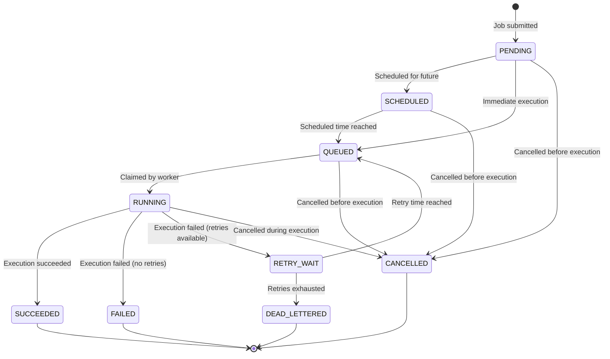

# NEXUS CORE - Job Lifecycle

## Job States

### State Definitions

| State | Description | Terminal |
|-------|-------------|----------|
| `PENDING` | Job has been submitted but not yet scheduled | No |
| `SCHEDULED` | Job is scheduled for future execution | No |
| `QUEUED` | Job is ready to be claimed by a worker | No |
| `RUNNING` | Job is currently being executed by a worker | No |
| `SUCCEEDED` | Job completed successfully | Yes |
| `FAILED` | Job failed with no retries remaining | Yes |
| `RETRY_WAIT` | Job failed and is waiting for retry | No |
| `CANCELLED` | Job was cancelled before or during execution | Yes |
| `DEAD_LETTERED` | Job exhausted all retry attempts | Yes |

## State Transitions

### Valid Transitions



### Transition Rules

**PENDING → SCHEDULED**
- Trigger: Job submitted with a future `scheduled_at` time
- Action: Set `status = SCHEDULED`, `scheduled_at` is set to future time
- Conditions: `scheduled_at > NOW()`

**PENDING → QUEUED**
- Trigger: Job submitted with immediate or past `scheduled_at` time
- Action: Set `status = QUEUED`
- Conditions: `scheduled_at <= NOW()`

**SCHEDULED → QUEUED**
- Trigger: Scheduled time has been reached
- Action: Set `status = QUEUED`
- Conditions: `scheduled_at <= NOW()`
- Performed by: Scheduler component

**QUEUED → RUNNING**
- Trigger: Worker claims the job
- Action: Set `status = RUNNING`, `claimed_at = NOW()`, `lease_expires_at = NOW() + lease_duration`, `worker_id`
- Conditions: Job is claimable (not already claimed, lease not expired)
- Performed by: Worker using `FOR UPDATE SKIP LOCKED`

**RUNNING → SUCCEEDED**
- Trigger: Job handler returns success
- Action: Set `status = SUCCEEDED`, `completed_at = NOW()`, clear `lease_expires_at`
- Conditions: Handler execution completed without error
- Performed by: Worker after successful execution

**RUNNING → FAILED**
- Trigger: Job handler fails and no retries remain
- Action: Set `status = FAILED`, `completed_at = NOW()`, `last_error_message`, `last_error_details`, clear `lease_expires_at`
- Conditions: `attempt_count >= max_attempts` or failure is non-retryable
- Performed by: Worker after failed execution

**RUNNING → RETRY_WAIT**
- Trigger: Job handler fails and retries remain
- Action: Set `status = RETRY_WAIT`, `scheduled_at = calculated_retry_time`, increment `attempt_count`, `last_error_message`, `last_error_details`, clear `lease_expires_at`
- Conditions: `attempt_count < max_attempts` and failure is retryable
- Performed by: Worker after failed execution

**RETRY_WAIT → QUEUED**
- Trigger: Retry time has been reached
- Action: Set `status = QUEUED`
- Conditions: `scheduled_at <= NOW()`
- Performed by: Scheduler component

**RETRY_WAIT → DEAD_LETTERED**
- Trigger: Retries exhausted during retry wait
- Action: Set `status = DEAD_LETTERED`, `completed_at = NOW()`
- Conditions: Manual intervention or policy change
- Performed by: Admin operation or policy enforcement

**PENDING/SCHEDULED/QUEUED → CANCELLED**
- Trigger: Cancellation request
- Action: Set `status = CANCELLED`, `completed_at = NOW()`
- Conditions: Job has not started execution
- Performed by: API endpoint

**RUNNING → CANCELLED**
- Trigger: Cancellation request during execution
- Action: Set `status = CANCELLED`, `completed_at = NOW()`, clear `lease_expires_at`
- Conditions: Worker may still be running but will check status
- Performed by: API endpoint (worker should respect cancellation)

**Any → DEAD_LETTERED**
- Trigger: Job cannot be recovered
- Action: Set `status = DEAD_LETTERED`, `completed_at = NOW()`
- Conditions: Manual admin intervention or system error
- Performed by: Admin operation

## Claiming and Leasing

### Job Claiming Mechanism

Workers claim jobs using PostgreSQL row-level locking:

```sql
BEGIN TRANSACTION;

SELECT * FROM jobs
WHERE status = 'QUEUED'
  AND scheduled_at <= NOW()
ORDER BY priority DESC, created_at ASC
LIMIT 10
FOR UPDATE SKIP LOCKED;

UPDATE jobs
SET status = 'RUNNING',
    claimed_at = NOW(),
    lease_expires_at = NOW() + INTERVAL '5 minutes',
    worker_id = 'worker-123'
WHERE id = ?;

COMMIT;
```

### Lease Semantics

**Lease Purpose:**
- Prevent infinite claim ownership if worker crashes
- Allow other workers to reclaim abandoned jobs
- Enable graceful worker shutdown

**Lease Duration:**
- Default: 5 minutes
- Configurable per job type or globally
- Should be longer than expected job execution time

**Lease Renewal:**
- For long-running jobs, workers periodically renew leases
- Renewal updates `lease_expires_at` without changing job state
- Renewal frequency: Every 2-3 minutes

**Lease Expiration:**
- Jobs with `lease_expires_at < NOW()` are considered abandoned
- Recovery process: Set status back to `QUEUED` or `RETRY_WAIT`
- Performed by: Worker polling for abandoned jobs

### Abandoned Job Recovery

```sql
UPDATE jobs
SET status = 'QUEUED',
    claimed_at = NULL,
    lease_expires_at = NULL,
    worker_id = NULL
WHERE status = 'RUNNING'
  AND lease_expires_at < NOW()
  AND last_execution_started_at < NOW() - INTERVAL '10 minutes';
```

The 10-minute guard ensures we don't immediately reclaim jobs that just had their lease expire.

## Execution Attempts

### Attempt Tracking

Each execution attempt is recorded in `job_execution_attempts`:

```sql
INSERT INTO job_execution_attempts (
    job_id,
    attempt_number,
    worker_id,
    started_at,
    status
) VALUES (?, ?, ?, NOW(), 'RUNNING');
```

### Attempt Lifecycle

1. **Started** - Create attempt record when job execution begins
2. **Completed** - Update attempt record when execution finishes
3. **Error Details** - Record error message and details if failed

### Attempt Numbering

- Attempt numbers start at 1
- Incremented on each execution attempt
- Used to track retry count vs max attempts

### Attempt Metadata

- `worker_id` - Which worker executed the attempt
- `started_at` - When execution began
- `completed_at` - When execution finished
- `status` - Outcome of the attempt
- `error_message` - Human-readable error description
- `error_details` - Structured error information (stack trace, error codes)

## Retries

### Retry Policy Configuration

Retry policy is stored as JSONB in the job:

```json
{
  "strategy": "exponential",
  "initialDelaySeconds": 60,
  "maxDelaySeconds": 3600,
  "multiplier": 2.0,
  "jitter": true,
  "maxAttempts": 3
}
```

### Retry Strategies

**Fixed Delay:**
```json
{
  "strategy": "fixed",
  "delaySeconds": 60
}
```

**Exponential Backoff:**
```json
{
  "strategy": "exponential",
  "initialDelaySeconds": 60,
  "multiplier": 2.0,
  "maxDelaySeconds": 3600
}
```

**With Jitter:**
Add randomness to retry times to prevent thundering herd:

```json
{
  "strategy": "exponential",
  "initialDelaySeconds": 60,
  "multiplier": 2.0,
  "jitter": true
}
```

### Retry Calculation

**Exponential Backoff Formula:**
```
delay = min(initialDelay * (multiplier ^ (attempt - 1)), maxDelay)
if jitter:
    delay = delay * (0.8 + random() * 0.4)  // ±20% jitter
```

**Example (exponential, initial=60s, multiplier=2, max=3600s):**
- Attempt 1: 60s
- Attempt 2: 120s
- Attempt 3: 240s
- Attempt 4: 480s
- Attempt 5: 960s
- Attempt 6: 1920s
- Attempt 7: 3600s (capped at max)

### Failure Classification

**Retryable Failures:**
- Network timeouts
- Temporary service unavailability
- Rate limit errors (429)
- Transient database errors
- 5xx server errors

**Non-Retryable Failures:**
- Validation errors (400)
- Authentication errors (401)
- Authorization errors (403)
- Not found errors (404)
- Business logic errors
- Data integrity violations

### Retry Exhaustion

When `attempt_count >= max_attempts`:
- Transition to `FAILED` state
- Record final error details
- Do not schedule additional retries
- Job remains in failed state for inspection

## Timeouts

### Execution Timeout

Each job can have a `timeout_seconds` value:

- If set, worker must enforce timeout
- If execution exceeds timeout, worker should:
  - Cancel the execution (if possible)
  - Mark job as failed
  - Record timeout error
  - Proceed with retry if applicable

### Timeout Enforcement

```java
try {
    CompletableFuture<Void> execution = CompletableFuture.runAsync(() -> handler.execute(job));
    execution.get(job.getTimeoutSeconds(), TimeUnit.SECONDS);
} catch (TimeoutException e) {
    // Mark job as failed with timeout error
}
```

### Lease vs Timeout

- **Lease timeout** - Protects against worker crashes (system-level)
- **Execution timeout** - Protects against hung handlers (application-level)
- Both should be configured appropriately

## Cancellation

### Cancellation Eligibility

Jobs can be cancelled in these states:
- `PENDING` - Before scheduling
- `SCHEDULED` - Before queued
- `QUEUED` - Before claimed
- `RUNNING` - During execution (best effort)

Jobs cannot be cancelled in these states:
- `SUCCEEDED` - Already completed
- `FAILED` - Already failed
- `CANCELLED` - Already cancelled
- `DEAD_LETTERED` - Permanently failed

### Cancellation Process

**API Request:**
```http
POST /api/v1/jobs/{jobId}/cancel
```

**Database Update:**
```sql
UPDATE jobs
SET status = 'CANCELLED',
    completed_at = NOW(),
    lease_expires_at = NULL
WHERE id = ?
  AND status IN ('PENDING', 'SCHEDULED', 'QUEUED', 'RUNNING');
```

**Worker Behavior:**
- Worker checks job status before execution
- If job is `CANCELLED`, worker should:
  - Abort execution if possible
  - Release lease
  - Record cancellation in execution attempt

### Cancellation of Running Jobs

Cancellation of running jobs is best-effort:
- Workers periodically check job status during execution
- Handlers can be designed to respect cancellation signals
- System may interrupt thread execution (use with caution)

## Recovery Behavior

### Worker Crash Recovery

When a worker crashes during execution:

1. **Lease Expiration** - Job's `lease_expires_at` will eventually expire
2. **Abandoned Job Detection** - Other workers detect jobs with expired leases
3. **Recovery Process** - Job is transitioned back to `QUEUED` or `RETRY_WAIT`
4. **Re-execution** - Job is claimed by another worker

### Recovery Logic

```sql
-- Detect abandoned jobs
SELECT * FROM jobs
WHERE status = 'RUNNING'
  AND lease_expires_at < NOW()
  AND last_execution_started_at < NOW() - INTERVAL '10 minutes';

-- Recover job
UPDATE jobs
SET status = 'RETRY_WAIT',
    claimed_at = NULL,
    lease_expires_at = NULL,
    worker_id = NULL,
    scheduled_at = NOW() + INTERVAL '60 seconds',
    attempt_count = attempt_count + 1
WHERE id = ?;
```

### Database Connection Loss

If database connection is lost during job claiming:
- Transaction will roll back
- Job remains in `QUEUED` state
- Another worker can claim it

### Partial State Corruption

If partial state corruption occurs:
- Use validation constraints to detect invalid states
- Admin can manually correct job state
- Consider adding job validation and repair tool

## Edge Cases

### Duplicate Job Submission

Protected by idempotency key:
- If same idempotency key is submitted, return existing job
- Unique constraint on `(tenant_id, idempotency_key)` prevents duplicates

### Concurrent Cancellation

If cancellation and execution occur simultaneously:
- Cancellation transaction will wait for execution transaction
- If execution completes first, cancellation may fail (job already terminal)
- If cancellation completes first, worker should respect cancellation

### Lease Race Conditions

Multiple workers may attempt to claim same job:
- `FOR UPDATE SKIP LOCKED` prevents this
- Only one worker gets the lock
- Others skip to next job

### Clock Skew

Clock differences between workers and database:
- Use database time for all time comparisons
- Workers rely on `NOW()` from database, not local clock
- Lease expiration uses database time

### Scheduled Time in Past

If job is scheduled for past time:
- Scheduler should immediately transition to `QUEUED`
- Job becomes eligible for claiming

### Zero Retries

If `max_attempts = 0`:
- Job has no retry capability
- First failure transitions directly to `FAILED`
- Should be configured intentionally

## State Machine Implementation

### State Transition Validation

All state transitions should be validated:

```java
public boolean canTransition(JobStatus from, JobStatus to) {
    return VALID_TRANSITIONS.getOrDefault(from, Set.of()).contains(to);
}
```

### State Transition Events

Each transition should emit an event for:
- Observability
- Webhook delivery
- Audit logging

### State Persistence

All state changes must be:
- Transactional
- Atomic
- Durable
- Idempotent
