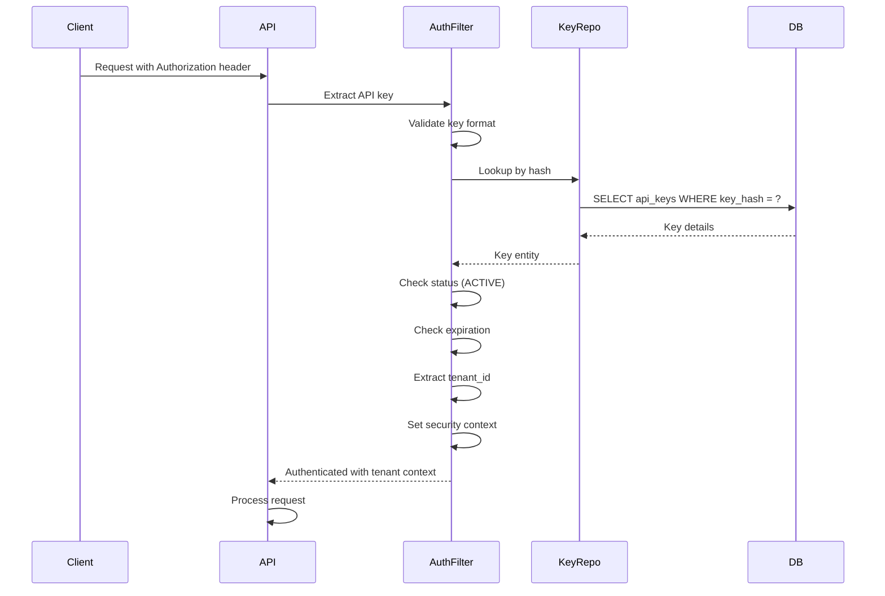

# NEXUS CORE - Security Model

## Tenant Isolation

### Multi-Tenant Architecture

NEXUS CORE is designed as a multi-tenant platform where each tenant (organization/customer) operates in complete isolation from others.

### Tenant Identification

Tenants are identified by a UUID stored in the `tenants` table:
- Each tenant has a unique ID
- Tenant context is extracted from the API key during authentication
- All subsequent operations are scoped to the tenant context

### Tenant Isolation Layers

**1. API Layer**
- Authentication filter extracts tenant from API key
- Request is rejected if tenant cannot be determined
- Tenant context is stored in security context

**2. Service Layer**
- All service methods receive tenant context
- Queries are automatically filtered by tenant_id
- Cross-tenant operations are explicitly prevented

**3. Repository Layer**
- Repository methods include tenant filtering
- JPA queries use `WHERE tenant_id = :tenantId`
- Custom queries must include tenant filter

**4. Database Layer (Optional Future)**
- Row-Level Security (RLS) can be added for additional protection
- Requires careful management with connection pooling
- Should be tested thoroughly before enabling

### Tenant Ownership Enforcement

All tenant-owned resources include a `tenant_id` foreign key:
- Jobs
- API keys
- Recurring schedules
- Webhook endpoints
- Outbox events

Queries must always include tenant filtering:

```java
@Query("SELECT j FROM Job j WHERE j.tenantId = :tenantId")
List<Job> findByTenantId(@Param("tenantId") UUID tenantId);
```

### Cross-Tenant Access Prevention

**Prevention at Application Level:**
- Service layer validates tenant context before operations
- Repository layer includes tenant filtering in all queries
- Authorization checks ensure users cannot access other tenants' data

**Prevention at Database Level (Future):**
- Row-Level Security policies can enforce tenant isolation
- Example RLS policy:
  ```sql
  CREATE POLICY tenant_isolation ON jobs
      USING (tenant_id = current_setting('app.current_tenant_id')::uuid);
  ```

**Prevention through Foreign Keys:**
- ON DELETE CASCADE ensures cleanup when tenant is deleted
- Foreign key constraints prevent orphaned records

## API Key Lifecycle

### API Key Generation

**Key Format:**
```
nx_live_<random-32-char-string>
nx_test_<random-32-char-string>
```

**Generation Process:**
1. Generate cryptographically secure random string (32 bytes)
2. Add prefix (`nx_live_` or `nx_test_`)
3. Hash the full key using SHA-256 or bcrypt
4. Store the hash in the database
5. Return the full key to the user (only time it's shown)

**Key Storage:**
- Never store plaintext API keys
- Store only the hash (SHA-256 or bcrypt)
- Store the prefix separately for identification
- The full key is never logged

### API Key Scopes

API keys can have permission scopes to limit access:

**Scope Examples:**
- `jobs:read` - Read job information
- `jobs:write` - Create and manage jobs
- `schedules:read` - Read schedule information
- `schedules:write` - Create and manage schedules
- `webhooks:read` - Read webhook information
- `webhooks:write` - Create and manage webhooks
- `admin` - Full administrative access (internal use only)

**Scope Enforcement:**
- Scopes are stored as an array in the API key
- Authorization checks validate required scopes before operations
- Missing scope results in 403 Forbidden

### API Key Rotation

**Rotation Process:**
1. Create new API key
2. Update application to use new key
3. Wait for transition period (e.g., 24 hours)
4. Revoke old API key

**Implementation:**
- Old key can remain active during transition
- Set `expires_at` on old key to enforce expiration
- Log key creation and revocation for audit

### API Key Revocation

**Revocation Methods:**
- Set status to `REVOKED`
- Set `expires_at` to past timestamp
- Delete key (soft delete recommended for audit)

**Revocation Effect:**
- Revoked keys are immediately rejected
- Active operations may complete (tokens are not used after initial auth)
- Revocation is logged for audit

### API Key Expiration

**Expiration Configuration:**
- Keys can have an optional `expires_at` timestamp
- Expired keys are rejected during authentication
- Expiration is checked on every authentication attempt

**No Expiration:**
- If `expires_at` is NULL, key does not expire
- Recommended for production keys with rotation process
- Test keys should have short expiration

## Authentication

### Authentication Flow



### Authentication Implementation

**Filter-Based Authentication:**
```java
@Component
public class ApiKeyAuthenticationFilter extends OncePerRequestFilter {

    @Override
    protected void doFilterInternal(HttpServletRequest request,
                                    HttpServletResponse response,
                                    FilterChain filterChain) {
        String authorization = request.getHeader("Authorization");
        if (authorization != null && authorization.startsWith("Bearer ")) {
            String apiKey = authorization.substring(7);
            ApiKey key = apiKeyRepository.findByHash(hash(apiKey));
            if (key != null && key.isActive()) {
                SecurityContext context = SecurityContextHolder.createEmptyContext();
                context.setAuthentication(new ApiKeyAuthentication(key));
                SecurityContextHolder.setContext(context);
            }
        }
        filterChain.doFilter(request, response);
    }
}
```

### Security Context

**Tenant Context:**
- Stored in Spring Security context
- Accessible via `SecurityContextHolder`
- Contains tenant ID and permissions

**Thread Local Storage:**
- Tenant context is thread-bound
- Must be cleared after request completion
- Prevents context leakage between requests

## Authorization

### Permission Model

**Role-Based Access Control (RBAC):**
- API keys have scopes (permissions)
- Each operation requires specific scopes
- Authorization checks occur at service layer

**Scope Examples:**
```java
@PreAuthorize("hasAuthority('jobs:write')")
public Job createJob(CreateJobRequest request) {
    // Only keys with jobs:write scope can access
}
```

### Authorization Enforcement

**Service Layer Checks:**
```java
public void authorize(String requiredScope) {
    ApiKeyAuthentication auth = SecurityContextHolder.getContext().getAuthentication();
    if (!auth.getScopes().contains(requiredScope)) {
        throw new AccessDeniedException("Insufficient permissions");
    }
}
```

**Resource Ownership:**
- Verify tenant owns the resource being accessed
- Prevent cross-tenant data access
- Example:
  ```java
  public Job getJob(UUID jobId) {
      Job job = jobRepository.findById(jobId);
      if (!job.getTenantId().equals(getCurrentTenantId())) {
          throw new AccessDeniedException("Not your job");
      }
      return job;
  }
  ```

## Secret Storage

### API Key Secrets

**Storage Requirements:**
- Hash API keys using SHA-256 or bcrypt
- Never store plaintext keys
- Store prefix separately for identification
- Use salt if using bcrypt

**Hashing Example:**
```java
String key = "nx_live_abc123...";
String hash = DigestUtils.sha256Hex(key);
// Store hash in database
```

### Webhook Secrets

**Storage Requirements:**
- Hash webhook secrets
- Store only the hash
- Use for request signing verification

**Usage:**
- Secret is used to sign webhook requests
- Recipient verifies signature using their secret
- Platform never returns the secret after creation

### Configuration Secrets

**Database Credentials:**
- Store in environment variables
- Never commit to repository
- Use Docker secrets or vault in production

**Other Secrets:**
- JWT signing keys (if used)
- Encryption keys (if used)
- Third-party API keys

## Request Validation

### Input Validation

**Framework-Level Validation:**
- Jakarta Bean Validation annotations
- Validate request DTOs
- Automatic validation error responses

**Example:**
```java
public record CreateJobRequest(
    @NotBlank String jobType,
    @NotNull JsonNode payload,
    @Min(0) @Max(10) Integer priority
) {}
```

**Business Logic Validation:**
- Custom validation in service layer
- Validate business rules
- Check constraints not covered by annotations

### Request Size Limits

**Prevent DoS:**
- Limit request body size (e.g., 1MB)
- Limit JSON payload size
- Reject oversized requests

**Configuration:**
```yaml
spring:
  servlet:
    multipart:
      max-file-size: 1MB
      max-request-size: 1MB
```

### SQL Injection Prevention

**Prevention Measures:**
- Use JPA parameterized queries
- Never concatenate user input into SQL
- Use JPA Criteria API for dynamic queries
- Validate and sanitize user input

**Example:**
```java
// Good
@Query("SELECT j FROM Job j WHERE j.tenantId = :tenantId")
List<Job> findByTenantId(@Param("tenantId") UUID tenantId);

// Bad
String query = "SELECT j FROM Job j WHERE j.tenantId = '" + tenantId + "'";
```

### XSS Prevention

**Prevention Measures:**
- Sanitize user input before rendering
- Escape output in responses
- Use Content Security Policy headers
- Validate input format

## Abuse Prevention

### Rate Limiting

**Implementation:**
- Rate limit per tenant
- Default: 100 requests per minute
- Configurable per tenant
- Use bucket token algorithm

**Headers:**
```
X-RateLimit-Limit: 100
X-RateLimit-Remaining: 95
X-RateLimit-Reset: 1234567890
```

**Configuration:**
```java
@RateLimiter(name = "api", fallbackMethod = "rateLimitFallback")
public ResponseEntity<?> createJob(@RequestBody CreateJobRequest request) {
    // Handler
}
```

### Job Submission Limits

**Tenant-Level Limits:**
- Maximum concurrent jobs per tenant
- Maximum jobs per day per tenant
- Configurable per tenant

**Implementation:**
- Check limits before job submission
- Reject with 429 if limit exceeded
- Log limit violations

### Handler Allowlisting

**Security Requirement:**
- NEXUS CORE must NOT execute arbitrary code
- Only registered, allowlisted handlers can be executed
- Handlers are registered at application startup

**Handler Registry:**
```java
@Component
public class HandlerRegistry {
    private final Map<String, JobHandler> handlers = new ConcurrentHashMap<>();

    public void register(String type, JobHandler handler) {
        handlers.put(type, handler);
    }

    public JobHandler get(String type) {
        if (!handlers.containsKey(type)) {
            throw new IllegalArgumentException("Unknown job type: " + type);
        }
        return handlers.get(type);
    }
}
```

**Registration:**
```java
@PostConstruct
public void registerHandlers() {
    handlerRegistry.register("email.send", new EmailSendHandler());
    handlerRegistry.register("report.generate", new ReportGenerateHandler());
    // Only allowlisted handlers
}
```

## Operational Security

### Audit Logging

**Sensitive Operations to Log:**
- API key creation and revocation
- Tenant creation and deletion
- Configuration changes
- Admin operations
- Security events (failed auth, authorization failures)

**Log Format:**
```json
{
  "timestamp": "2024-01-01T00:00:00Z",
  "level": "INFO",
  "event": "api_key_created",
  "tenantId": "uuid",
  "userId": "uuid",
  "details": { ... }
}
```

### Secure Error Responses

**Error Message Guidelines:**
- Do not expose stack traces in production
- Do not reveal internal system details
- Provide generic error messages to users
- Log detailed errors for operators

**Example:**
```java
// User sees
{
  "error": {
    "code": "INTERNAL_ERROR",
    "message": "An error occurred processing your request"
  }
}

// Logs contain
{
  "timestamp": "2024-01-01T00:00:00Z",
  "level": "ERROR",
  "exception": "NullPointerException",
  "stackTrace": "..."
}
```

### Security Headers

**Recommended Headers:**
```
X-Content-Type-Options: nosniff
X-Frame-Options: DENY
X-XSS-Protection: 1; mode=block
Strict-Transport-Security: max-age=31536000; includeSubDomains
Content-Security-Policy: default-src 'self'
```

### HTTPS Enforcement

**Production Requirement:**
- All API communication must use HTTPS
- Redirect HTTP to HTTPS
- Use TLS 1.2 or higher
- Valid SSL certificate

**Configuration:**
```yaml
server:
  ssl:
    enabled: true
    key-store: classpath:keystore.p12
    key-store-password: ${SSL_PASSWORD}
```

## Future Security Enhancements

### OAuth2 / SSO

**Not in Initial Scope:**
- OAuth2 provider integration
- SAML SSO
- OpenID Connect

**Future Consideration:**
- Add when enterprise customers require it
- Use Spring Security OAuth2
- Keep API keys as primary mechanism

### Row-Level Security

**PostgreSQL RLS:**
- Additional layer of tenant isolation
- Requires careful tenant context management
- Test thoroughly with connection pooling

**Implementation Considerations:**
- Set tenant context per database connection
- Use `current_setting` for tenant ID
- Ensure connection pool handles context correctly

### Encryption at Rest

**Database Encryption:**
- Consider for sensitive payloads
- Use PostgreSQL transparent data encryption
- Or application-level encryption

**Considerations:**
- Performance impact
- Key management complexity
- Compliance requirements

## Security Checklist

### Development
- [ ] All secrets stored in environment variables
- [ ] API keys hashed before storage
- [ ] Input validation on all endpoints
- [ ] Tenant filtering on all queries
- [ ] Authorization checks on sensitive operations
- [ ] Handler allowlisting enforced
- [ ] No arbitrary code execution

### Production
- [ ] HTTPS enabled
- [ ] Security headers configured
- [ ] Rate limiting enabled
- [ ] Audit logging enabled
- [ ] Error messages sanitized
- [ ] Database access restricted
- [ ] Regular security audits
- [ ] Dependency updates monitored
