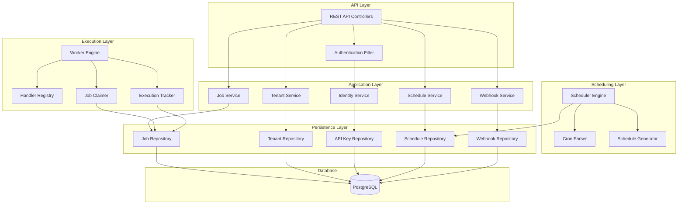
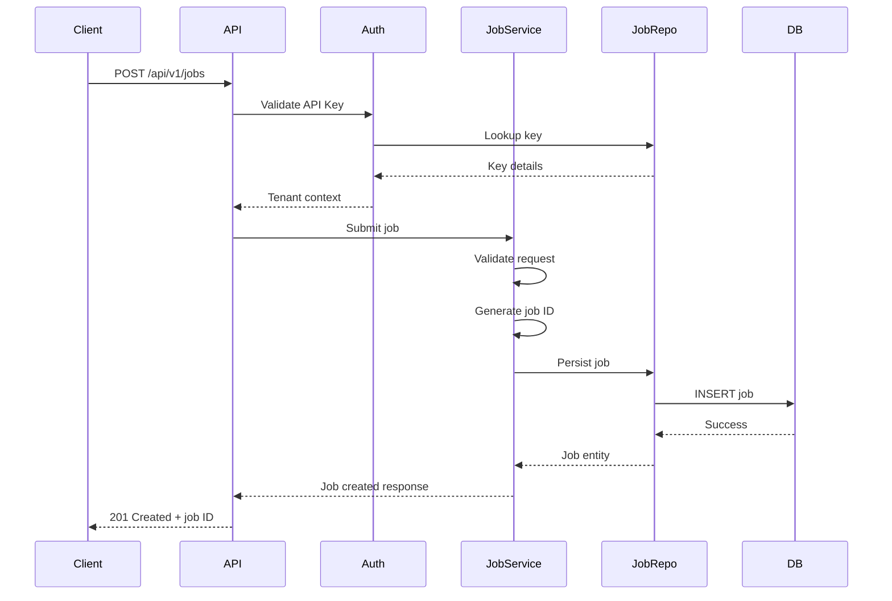
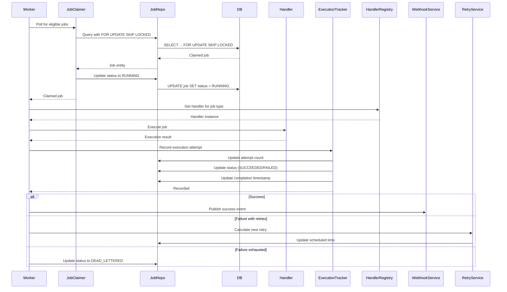
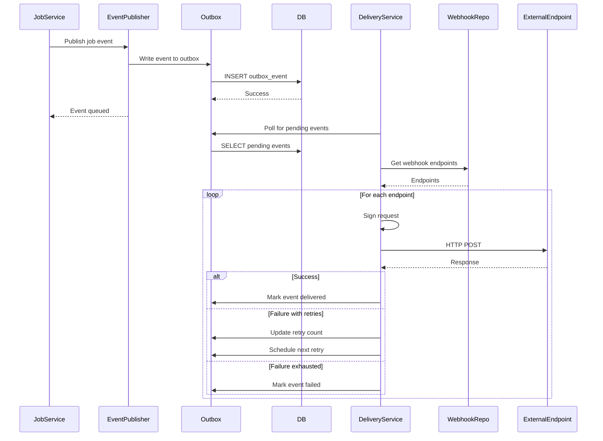
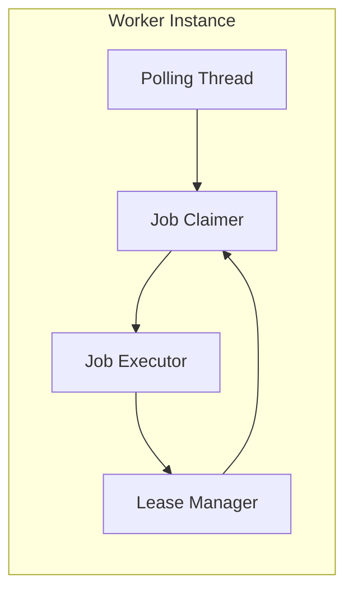
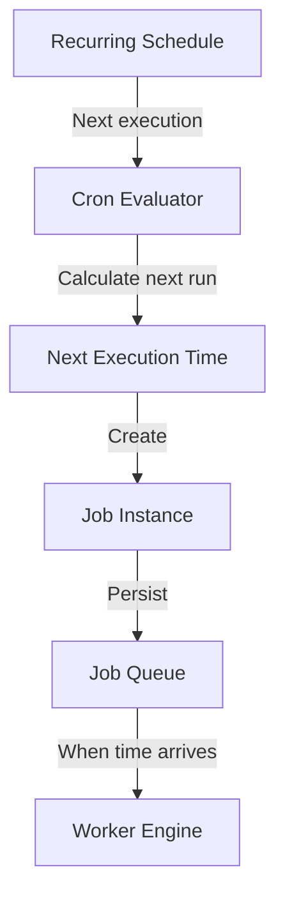
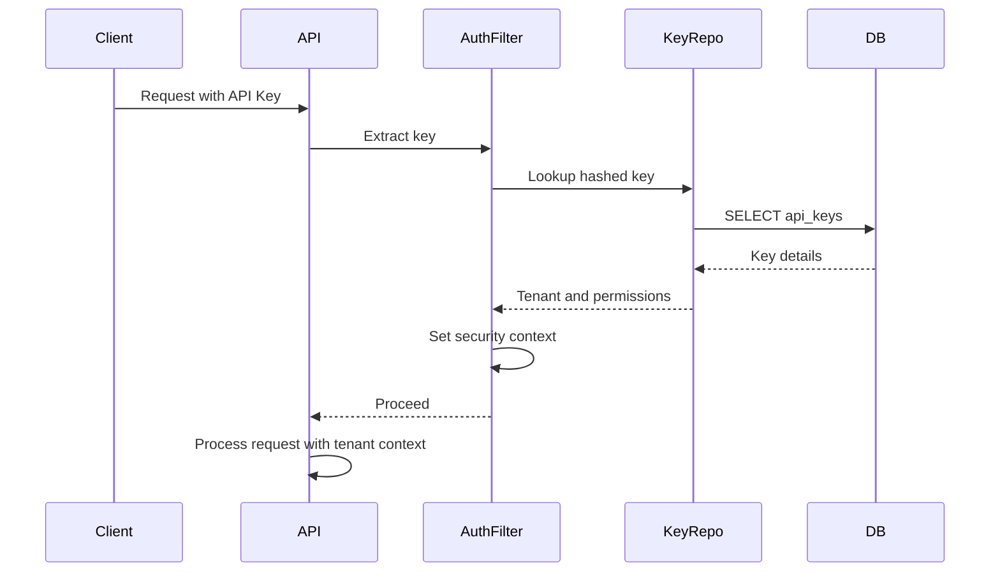

# NEXUS CORE - System Architecture

## Architectural Approach

NEXUS CORE follows a **modular monolith** architecture. This approach provides:

- Clear separation of concerns within a single deployable unit
- Well-defined internal module boundaries that can evolve
- Simple deployment and operational model
- Future ability to extract services if scaling requirements justify it

We do not begin with microservices. Microservices introduce operational complexity, distributed transaction challenges, and network overhead. The modular monolith allows us to:

1. Ship features faster with simpler deployment
2. Maintain transaction boundaries within a single database
3. Avoid distributed system complexity until necessary
4. Extract services when actual scaling requirements emerge

## Module Responsibilities

### Common Module
**Responsibilities:**
- Shared types and value objects
- Error handling abstractions
- Common utilities
- Shared infrastructure abstractions
- Base exception classes
- Common DTO patterns

**Key Components:**
- Custom exception hierarchy
- Standard error response models
- Utility classes for common operations
- Shared constants and enums

### Tenant Module
**Responsibilities:**
- Tenant management
- Tenant context propagation
- Tenant configuration
- Tenant-level rate limiting
- Tenant isolation enforcement

**Key Components:**
- Tenant entity and repository
- Tenant context holder (ThreadLocal)
- Tenant-aware filters and interceptors
- Tenant configuration service

### Identity Module
**Responsibilities:**
- API key generation and management
- Authentication (API key validation)
- Authorization (permission checks)
- Key lifecycle (creation, rotation, revocation, expiration)

**Key Components:**
- API key entity with hashed storage
- API key repository
- Authentication filter
- Permission evaluator
- Key generation service

### Job Module
**Responsibilities:**
- Job submission API
- Job lifecycle management
- Job retrieval and listing
- Job cancellation
- Job retry requests
- Job state transitions

**Key Components:**
- Job entity and repository
- Job submission service
- Job query service
- Job state machine
- Job DTOs and validators

### Execution Module
**Responsibilities:**
- Worker engine lifecycle
- Job claiming and leasing
- Handler registration
- Execution tracking
- Concurrency control
- Worker recovery

**Key Components:**
- Worker service (background polling engine)
- Job claimer with database locking
- Handler registry (allowlisted job types)
- Execution orchestrator
- Lease manager
- Execution tracking service

### Scheduler Module
**Responsibilities:**
- Delayed job scheduling
- Recurring schedule management
- Cron expression evaluation
- Schedule generation
- Timezone handling

**Key Components:**
- Schedule entity and repository
- Cron expression parser
- Schedule generator
- Schedule persistence service
- Timezone-aware scheduler

### Retry Module
**Responsibilities:**
- Retry policy configuration
- Backoff calculation (fixed, exponential)
- Failure classification
- Retry scheduling
- Dead-letter determination

**Key Components:**
- Retry policy engine
- Backoff calculator
- Failure classifier
- Retry service

### Webhook Module
**Responsibilities:**
- Webhook endpoint registration
- Event generation
- Outbound delivery
- Request signing
- Delivery retries
- Delivery history

**Key Components:**
- Webhook entity and repository
- Event publisher
- Delivery service
- Signature generator
- Delivery tracking

### Observability Module
**Responsibilities:**
- Metrics collection
- Health checks
- Execution statistics
- Structured logging
- Worker monitoring

**Key Components:**
- Custom metrics
- Health indicators
- Statistics service
- Logging configuration

### Admin Module
**Responsibilities:**
- Internal administrative operations
- Platform-level management
- System configuration
- Operational tools

**Key Components:**
- Admin endpoints (separate from tenant API)
- System configuration service
- Operational utilities

## Component Relationships



## Data Flow

### Job Submission Flow



### Job Execution Flow



### Webhook Delivery Flow



## Worker Architecture

### Worker Design Principles

1. **Poll-based discovery** - Workers poll the database for eligible jobs
2. **Durable claiming** - Job claims are persisted with lease expiration
3. **Concurrency control** - Multiple workers can run safely without duplicate execution
4. **Graceful shutdown** - Workers release claims on shutdown
5. **Lease expiration** - Jobs with expired leases are recovered by other workers

### Worker Components



### Job Claiming Strategy

We use PostgreSQL row-level locking with `FOR UPDATE SKIP LOCKED`:

```sql
SELECT * FROM jobs
WHERE status = 'QUEUED'
  AND scheduled_at <= NOW()
ORDER BY priority DESC, created_at ASC
LIMIT 10
FOR UPDATE SKIP LOCKED;
```

This provides:
- Atomic claiming within a transaction
- No lock contention (SKIP LOCKED skips already-locked rows)
- Safe multi-worker operation
- Distributed coordination through the database

### Lease Management

- Jobs are claimed with a lease expiration timestamp
- Workers periodically renew leases for long-running jobs
- If a worker crashes, the lease expires and other workers can reclaim
- Lease renewal is done in a separate transaction to avoid holding locks

## Scheduler Architecture

### Schedule Types

1. **Immediate** - Execute as soon as possible
2. **Delayed** - Execute at a specific future time
3. **Recurring** - Execute on a recurring schedule
4. **Cron** - Execute based on cron expression

### Cron-Based Scheduling



### Schedule Persistence

- Recurring schedules are stored separately from individual job executions
- Each schedule defines the cron expression, timezone, and job payload
- A scheduler component periodically evaluates schedules and creates job instances
- This separation allows independent management of schedules and executions

## Persistence Model

### Database as Source of Truth

PostgreSQL is the durable source of truth for:
- Job storage and state
- Schedule definitions
- Tenant data
- API keys
- Webhook endpoints
- Execution history
- Outbox events

### Transaction Boundaries

- API operations are transactional
- Job claiming is transactional with row-level locks
- Outbox event writing is transactional with the main operation
- Long-running operations (webhook delivery) are NOT transactional

### Connection Pooling

- HikariCP for connection pooling
- Appropriate pool size based on worker concurrency
- Connection validation and leak detection

## Security Boundaries

### Multi-Tenant Isolation

1. **API Layer** - Authentication and tenant context extraction
2. **Service Layer** - Tenant-aware queries and operations
3. **Repository Layer** - Tenant filtering in queries
4. **Database Layer** - Optional row-level security (future)

### Authentication Flow



### Authorization

- API keys are scoped to specific tenants
- API keys have permission scopes (e.g., jobs:read, jobs:write)
- Authorization checks at service layer
- No cross-tenant data access

## Scaling Strategy

### Horizontal Scaling

1. **Application instances** - Multiple API instances behind a load balancer
2. **Worker instances** - Multiple worker instances polling the same database
3. **Database** - Single PostgreSQL instance (read replicas for queries if needed)

### Scaling Points

- API instances scale based on request volume
- Worker instances scale based on job execution load
- Database is the coordination point (no Redis/Kafka needed initially)

### When to Extract Services

Consider extraction when:
- A module has independent scaling requirements
- A module has independent deployment needs
- A module has distinct data access patterns
- Operational complexity of a service is justified by clear benefits

## Technology Stack

### Backend
- Java 21 LTS
- Spring Boot 4.1.2
- Spring Security
- Spring Data JPA
- Hibernate
- Maven
- REST APIs
- Jakarta Bean Validation

### Database
- PostgreSQL
- Flyway database migrations
- Proper relational constraints and indexes
- Transaction management

### Infrastructure
- Docker
- Docker Compose
- PostgreSQL containers for development
- Testcontainers for integration testing

### Monitoring
- Spring Boot Actuator
- Structured application logging
- Metrics
- Health checks
- Execution statistics

### Future Dashboard
- Next.js
- TypeScript
- Tailwind CSS
- Clean component architecture
- API-driven communication with backend

## Code Organization

### Package-by-Feature Structure

```
com.techtune.nexus
├── common
│   ├── error
│   ├── types
│   └── util
├── tenant
│   ├── api
│   ├── application
│   ├── domain
│   ├── persistence
│   └── config
├── identity
│   ├── api
│   ├── application
│   ├── domain
│   ├── persistence
│   └── config
├── job
│   ├── api
│   ├── application
│   ├── domain
│   ├── persistence
│   └── config
├── execution
│   ├── api
│   ├── application
│   ├── domain
│   ├── persistence
│   └── config
├── scheduler
│   ├── api
│   ├── application
│   ├── domain
│   ├── persistence
│   └── config
├── retry
│   ├── application
│   └── domain
├── webhook
│   ├── api
│   ├── application
│   ├── domain
│   ├── persistence
│   └── config
├── observability
│   ├── metrics
│   └── health
└── admin
    ├── api
    └── application
```

### Layer Responsibilities

**API/Controller Layer:**
- HTTP request handling
- Input validation
- Response formatting
- Error handling

**Application/Service Layer:**
- Business logic
- Orchestration
- Transaction management
- Domain model coordination

**Domain/Model Layer:**
- Business entities
- Value objects
- Domain services
- Business rules

**Persistence Layer:**
- Repository interfaces
- JPA entities
- Database mapping
- Query implementation

**Configuration:**
- Spring configuration
- Bean definitions
- Security configuration
- Feature flags

### Design Principles

- Use constructor injection
- Prefer immutable DTOs
- Use Java records for suitable request/response models
- Avoid exposing JPA entities through public API responses
- Use interfaces where they create meaningful boundaries
- Keep classes focused
- Avoid giant service classes
- Eliminate circular dependencies
- Follow DRY (Don't Repeat Yourself)
